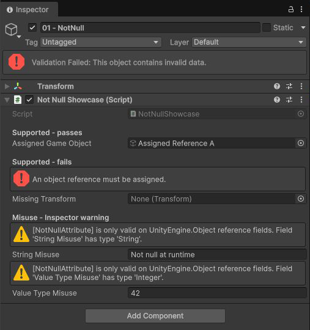
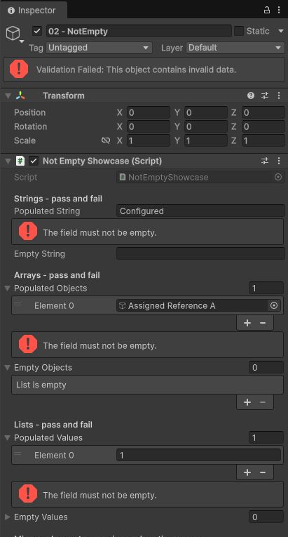
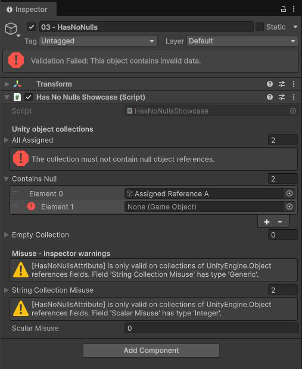
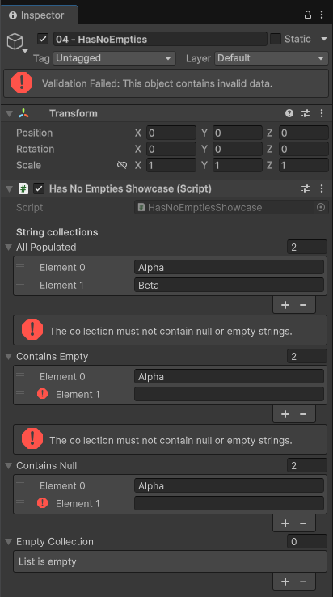
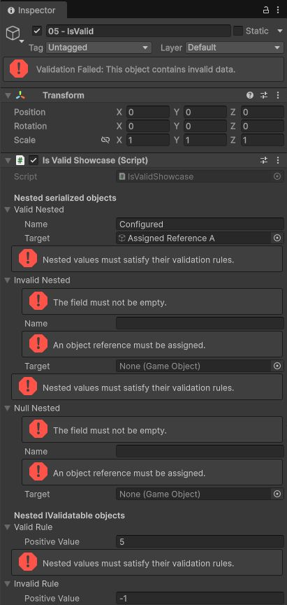

# UValidation

UValidation is a Unity package for catching invalid serialized content while it is still being
authored. It adds field-level validation messages to the Inspector, marks invalid objects in the
Hierarchy and Project windows, supports recursive and custom validation, and can optionally block
invalid saves, Play Mode, Editor quit, or player builds.

The package also includes a small fluent runtime API for validating values that do not come from
Unity serialization.

## Features

- Inspector validation attributes for required references, strings, collections, and nested data.
- Immediate error messages beside the field that failed validation.
- Validation feedback in the Hierarchy and Project windows.
- Recursive validation of serializable classes, structs, collections, and `[SerializeReference]`
  values.
- Custom rules through `IValidatable`.
- Fluent runtime validation with source location and Unity object context in diagnostics.
- Optional project-wide enforcement for saves, Play Mode, Editor quit, and player builds.
- Correct handling of destroyed `UnityEngine.Object` references, inherited serialized fields,
  prefabs, scenes, ScriptableObjects, sub-assets, and missing scripts.

## Requirements

- Unity 6.3 or newer.
- The legacy Hierarchy is supported in Unity 6.3 and newer.
- The UI Toolkit Hierarchy integration uses Unity's official extension API and is available in
  Unity 6.6 and newer.

### Unity version policy

UValidation is developed against the latest production-ready Unity release. The sandbox project
tracks that primary version, while the package's `unity` field defines the oldest compatibility
version. New engine capabilities are supported where Unity provides them; they are not reimplemented
for older releases.

The release matrix has two lanes:

- **Primary:** run the complete sandbox Edit Mode suite on the version declared by
  `UValidationSandbox/ProjectSettings/ProjectVersion.txt`.
- **Compatibility:** compile the package and run its core Edit Mode suite on Unity 6.3 LTS.

The GitHub Actions workflow requires the `UNITY_LICENSE`, `UNITY_EMAIL`, and `UNITY_PASSWORD`
repository secrets described by GameCI's Unity activation documentation.

## Installation

### Package Manager

In Unity, open **Window > Package Manager**, select **Install package from git URL**, and enter:

```text
https://github.com/mihai-rc/UValidation.git?path=/src#v0.1.0
```

To follow the development branch before a tagged release, replace `#v0.1.0` with `#dev`.

### Project manifest

Alternatively, add the package directly to your project's `Packages/manifest.json`:

```json
{
  "dependencies": {
    "com.uvalidation.validation": "https://github.com/mihai-rc/UValidation.git?path=/src#v0.1.0"
  }
}
```

Pinning a tag is recommended so package updates remain deliberate and reproducible.

## Quick start

Add validation attributes to fields that Unity serializes:

```csharp
using System;
using System.Collections.Generic;
using UnityEngine;
using UValidation;

public sealed class EnemyConfig : MonoBehaviour
{
    [SerializeField, NotNull] private Transform m_Target;
    [SerializeField, NotEmpty] private string m_Id;
    [SerializeField, NotEmpty, HasNoNulls] private List<GameObject> m_SpawnPoints = new();
    [SerializeField, HasNoEmpties] private List<string> m_Tags = new();
    [SerializeField, IsValid] private Stats m_Stats = new();

    [Serializable]
    private sealed class Stats
    {
        [SerializeField, NotEmpty] private string m_DisplayName;
    }
}
```

Invalid fields display an error in the Inspector. The owning component, GameObject, or asset also
receives validation feedback in the relevant Editor window.

## Attribute reference

| Attribute | Supported serialized fields | Rule |
| --- | --- | --- |
| `[NotNull]` | `UnityEngine.Object` references | The reference must be assigned. Destroyed Unity objects count as null. |
| `[NotEmpty]` | Strings, arrays, lists, and Unity 6.6+ dictionaries | The value must be non-null and contain at least one character or effective element. |
| `[HasNoNulls]` | Arrays/lists of `UnityEngine.Object` references and Unity 6.6+ dictionaries with object values | No element or dictionary value may be null or destroyed. An empty collection passes. |
| `[HasNoEmpties]` | Arrays/lists of strings and Unity 6.6+ dictionaries with string values | No element or dictionary value may be null or empty. An empty collection passes. |
| `[IsValid]` | Serializable classes, structs, arrays, lists, Unity 6.6+ dictionary values, and supported `[SerializeReference]` values | Recursively validates the nested serialized data. Null objects and null or empty collections are skipped. |

Combine collection attributes when the contract requires more than one guarantee. For example,
`[NotEmpty, HasNoNulls]` requires at least one element and rejects null elements.

### Serialized dictionaries

On Unity 6.6 and newer, validation attributes support fields declared exactly as
`Dictionary<TKey, TValue>` and serialized with `[SerializeField]`. Dictionary validation is
value-oriented: `[HasNoNulls]`, `[HasNoEmpties]`, and `[IsValid]` inspect `TValue`; keys remain
under Unity's built-in null-key and duplicate-key validation. `[NotEmpty]` counts only entries that
Unity includes in the live dictionary, so duplicate and null-key placeholder rows do not satisfy it.

```csharp
[SerializeField, NotEmpty, HasNoNulls]
private Dictionary<string, GameObject> m_Views = new();

[SerializeField, IsValid]
private Dictionary<string, ItemData> m_Items = new();
```

Unity does not serialize public dictionaries implicitly, and `[SerializeReference]` is not valid on
dictionary fields. Earlier Unity versions continue to treat dictionary fields as nonserialized.

Unsupported attribute placements produce an Inspector warning instead of silently promising a rule
that Unity cannot serialize or inspect.

## Inspector examples

The showcase scene pairs valid values with intentional failures and unsupported placements. Red
messages identify invalid data; yellow messages explain attribute placements that Unity cannot
validate.

<table>
  <tr>
    <th><code>[NotNull]</code></th>
    <th><code>[NotEmpty]</code></th>
  </tr>
  <tr>
    <td></td>
    <td></td>
  </tr>
  <tr>
    <th><code>[HasNoNulls]</code></th>
    <th><code>[HasNoEmpties]</code></th>
  </tr>
  <tr>
    <td></td>
    <td></td>
  </tr>
  <tr>
    <th colspan="2"><code>[IsValid]</code></th>
  </tr>
  <tr>
    <td colspan="2" align="center"></td>
  </tr>
</table>

## Recursive validation

Use `[IsValid]` on an inline custom serializable class or struct, or on an array or `List<T>` whose
element type is a custom serializable class or struct:

```csharp
[Serializable]
public sealed class ItemData
{
    [SerializeField, NotEmpty] private string m_Name;
}

[SerializeField, IsValid] private ItemData m_Item = new();
[SerializeField, IsValid] private List<ItemData> m_Items = new();
```

Every annotated field inside each object is validated recursively. An invalid `[IsValid]` target
shows one summary message above the outer field even while it is collapsed; expand it to see the
specific nested field messages. Collection failures include the element index, such as
`m_Items[2].m_Name`.

`[IsValid]` also supports `[SerializeReference]` fields declared as an interface, abstract class, or
`object`, including arrays and lists. Each assigned value is validated according to its runtime
type:

```csharp
[SerializeReference, IsValid] private IRule m_Rule;
[SerializeReference, IsValid] private List<IRule> m_Rules = new();
```

For a `[SerializeReference]` array or list declared with a class element type, Unity requires the
declared class to have `[Serializable]`. Interface and `object` collection declarations do not
require it, but every concrete assigned value must still be serializable.

`[IsValid]` controls traversal only. It does not require the nested value or collection to exist,
and it does not require a collection to contain elements. Add `[NotEmpty]` or another constraint
when that is part of the field's contract.

## Custom validation

Implement `IValidatable` when a type needs a rule that cannot be expressed by field attributes:

```csharp
using UnityEngine;
using UValidation;

public sealed class DamageConfig : MonoBehaviour, IValidatable
{
    [SerializeField] private int m_MinDamage;
    [SerializeField] private int m_MaxDamage;

    public void Validate(Validation validation)
    {
        validation.IsTrue(nameof(m_MinDamage), m_MinDamage <= m_MaxDamage);
    }
}
```

Custom validation is also invoked for nested values reached through `[IsValid]`. Their failures
receive the same nested path prefix as attribute failures. If an implementation throws, UValidation
records the exception as a failed diagnostic with the original stack trace.

## Runtime fluent validation

The `Validation` API can validate ordinary runtime values, including values that Unity does not
serialize:

```csharp
using var validation = new Validation(this);

validation
    .IsNotNull(nameof(m_Target), m_Target)
    .IsNotEmpty(nameof(m_Name), m_Name)
    .IsNotEmpty(nameof(m_ItemIds), m_ItemIds)
    .HasNoNulls(nameof(m_Views), m_Views)
    .HasNoEmpties(nameof(m_Tags), m_Tags)
    .IsTrue(nameof(m_MinDamage), m_MinDamage <= m_MaxDamage);

validation.Report();
```

Rules accumulate failures so one validation pass can report the complete problem set. Collection
rules are generic, destroyed Unity objects are recognized even when exposed as `object`, and
nullable value types have dedicated overloads.

Use the predicate overload when evaluation itself may throw and should be captured as a validation
failure:

```csharp
validation.IsTrue(nameof(m_Config), m_Config, config => config.CalculateValue() > 0);
```

Dispose the validation after reading `Passed` or `Failed`, reporting the result, or allowing the
`using` scope to end.

## Editor feedback and enforcement

Inspector messages and Hierarchy and Project window feedback are always active. Blocking policies
are configured separately under **Project Settings > UValidation**:

| Policy | Behavior |
| --- | --- |
| **Block Invalid Saves** | Blocks invalid scene, prefab, and ScriptableObject saves when Unity exposes the contents being written. |
| **Block Play Mode** | Prevents entering Play Mode while the active scene is invalid. |
| **Block Editor Quit** | Prevents quitting while a dirty ScriptableObject asset is invalid. |
| **Fail Player Builds** | Fails a player build when a processed scene contains invalid data. |

All enforcement policies are disabled in a fresh project. Settings are stored in
`ProjectSettings/UValidationSettings.asset`, allowing a team to commit and share them.

### Save behavior

Unity does not expose the same information for every save operation. UValidation avoids blocking a
write based on stale or unrelated data:

- A newly created scene, prefab, or ScriptableObject is allowed to complete its initial save. The
  imported asset is validated immediately afterward so it can be configured normally.
- Prefab Mode exposes the actual save root, so an invalid Prefab Mode save can be blocked before
  Unity writes it.
- Operations such as **Apply Overrides**, `PrefabUtility.SaveAsPrefabAsset`, and direct prefab-asset
  saves expose only the destination path. UValidation allows the write, then validates and
  highlights the imported prefab.
- Saving an open scene to its own path is blocked when invalid. **Save As** over a different existing
  scene is allowed and the written scene is validated after import because Unity's callback exposes
  the old destination contents rather than the scene being written.

## Showcase project

The repository includes `UValidationSandbox`, a Unity project linked to the local package source.
Open it with the Unity version recorded in
`UValidationSandbox/ProjectSettings/ProjectVersion.txt`.

Useful examples include:

- `Assets/Scenes/ValidationAttributeShowcase.unity`
- `Assets/Scenes/ValidationInheritanceShowcase.unity`
- `Assets/Showcase/ScriptableObjects`

The examples intentionally contain both valid and invalid values. See
`UValidationSandbox/Assets/Showcase/README.md` for the expected result of each object and asset.

## Development and tests

Clone the repository and open `UValidationSandbox` in Unity. Its project manifest references the
package through `file:../../src`, so edits under `src` are compiled directly.

Run the package tests from **Window > General > Test Runner > EditMode**. The suite covers runtime
rules, drawers, inherited fields, recursive and `[SerializeReference]` validation, scene and prefab
save enforcement, ScriptableObject assets and sub-assets, build processing, and Editor feedback.

Issues and focused pull requests are welcome. When changing behavior, include a regression test and
update the relevant documentation or showcase example.

## License

UValidation is available under the [MIT License](LICENSE).
